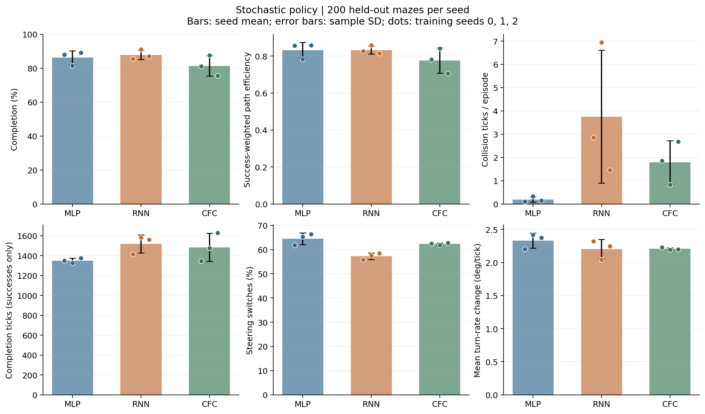
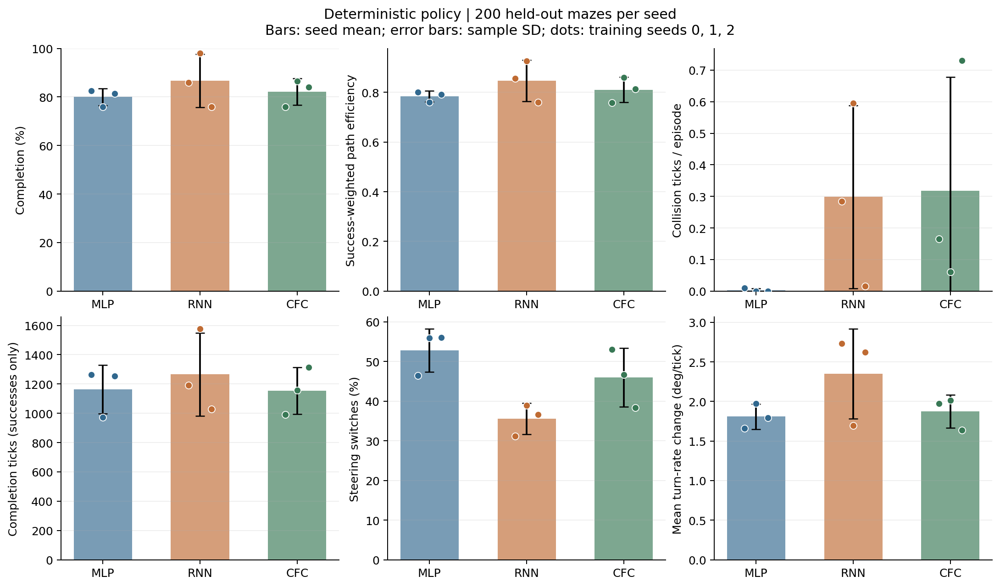
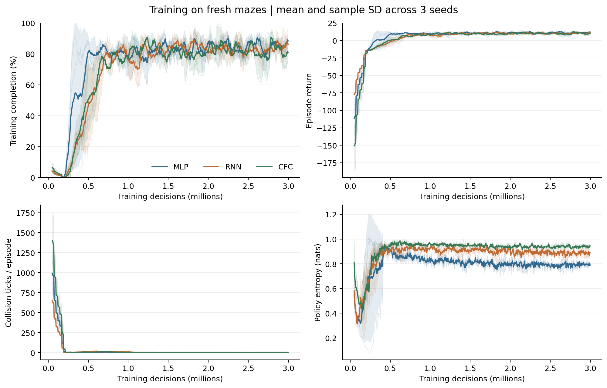
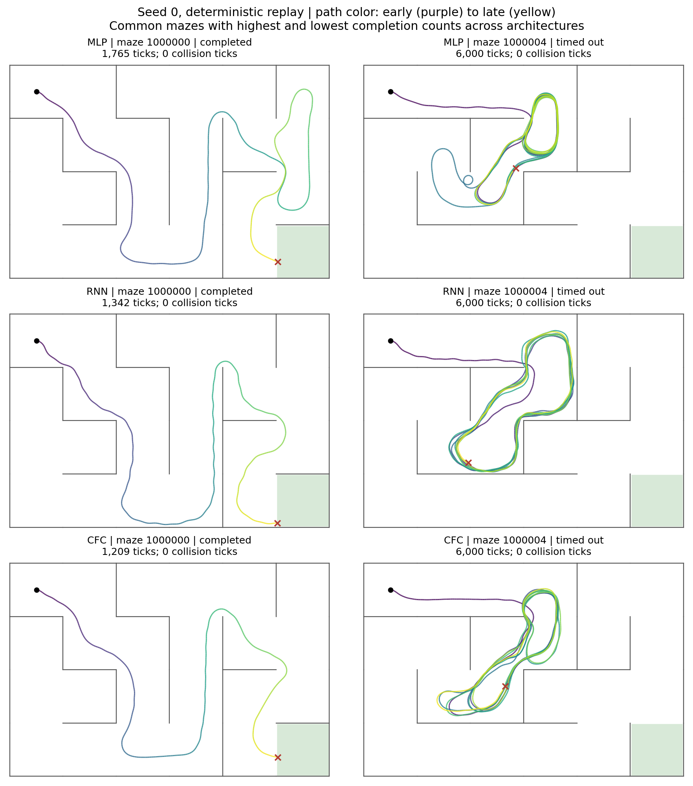

# Maze baseline results

MLP, RNN, and CfC trained with seeds 0, 1, and 2. Each run used 2,998,272 agent decisions (3,000,000 requested; the trainer uses complete 4,096-decision rollouts).

Each checkpoint was evaluated on the same 200 distinct held-out mazes with both policies: 3,600 evaluation episodes total. Values are means ± sample standard deviations across the three training seeds. Maze metrics are averaged within each seed first.

## Stochastic policy

| Model | Completion (%) | Path efficiency (SPL) | Collision ticks | Steering switches (%) | Turn-rate change |
| --- | ---: | ---: | ---: | ---: | ---: |
| MLP | 86.2 ± 4.1 | 0.832 ± 0.042 | 0.2 ± 0.1 | 64.5 ± 2.4 | 2.333 ± 0.114 |
| RNN | 87.8 ± 2.8 | 0.832 ± 0.022 | 3.8 ± 2.9 | 57.2 ± 1.4 | 2.205 ± 0.146 |
| CFC | 81.3 ± 6.0 | 0.775 ± 0.068 | 1.8 ± 0.9 | 62.3 ± 0.5 | 2.207 ± 0.019 |



## Deterministic policy

| Model | Completion (%) | Path efficiency (SPL) | Collision ticks | Steering switches (%) | Turn-rate change |
| --- | ---: | ---: | ---: | ---: | ---: |
| MLP | 80.0 ± 3.5 | 0.784 ± 0.021 | 0.0 ± 0.0 | 52.8 ± 5.5 | 1.809 ± 0.159 |
| RNN | 86.7 ± 11.0 | 0.847 ± 0.083 | 0.3 ± 0.3 | 35.6 ± 4.0 | 2.351 ± 0.569 |
| CFC | 82.2 ± 5.5 | 0.811 ± 0.050 | 0.3 ± 0.4 | 46.0 ± 7.4 | 1.874 ± 0.208 |



## Completion by training seed

| Model | Seed | Sampled: completed / 200 | Deterministic: completed / 200 |
| --- | ---: | ---: | ---: |
| MLP | 0 | 176 | 165 |
| MLP | 1 | 163 | 152 |
| MLP | 2 | 178 | 163 |
| RNN | 0 | 171 | 172 |
| RNN | 1 | 182 | 196 |
| RNN | 2 | 174 | 152 |
| CFC | 0 | 162 | 152 |
| CFC | 1 | 175 | 173 |
| CFC | 2 | 151 | 168 |

## Completion time and distance

Successful episodes only. Models can succeed on different subsets of mazes.

| Policy | Model | Physics ticks | Distance (pixels) |
| --- | --- | ---: | ---: |
| stochastic | MLP | 1350.8 ± 24.7 | 2685.7 ± 49.5 |
| stochastic | RNN | 1519.5 ± 91.3 | 3020.5 ± 181.5 |
| stochastic | CFC | 1483.8 ± 140.6 | 2950.2 ± 280.1 |
| deterministic | MLP | 1163.5 ± 165.8 | 2311.9 ± 331.7 |
| deterministic | RNN | 1265.7 ± 282.7 | 2514.7 ± 562.9 |
| deterministic | CFC | 1153.6 ± 160.3 | 2292.2 ± 320.6 |

## Training

| Model | Hidden units | Parameters | Mean training time (seconds) |
| --- | ---: | ---: | ---: |
| MLP | 69 | 6,076 | 126.1 |
| RNN | 69 | 6,076 | 158.7 |
| CFC | 32 | 5,828 | 248.1 |

The parameter target was 6,000. Runs used one CPU thread each, with three jobs running concurrently.



Curves align by training step. Thin lines show individual seeds; bands show sample standard deviations. Training episode metrics use the trainer's rolling window of 100 completed episodes.

## Observations

CfC minus RNN mean completion: -6.5 percentage points with the stochastic policy.

CfC minus RNN mean completion: -4.5 percentage points with the deterministic policy.

Three training seeds provide a baseline comparison; they do not establish a general architecture advantage. Low switching or turn-rate change can also describe an agent that circles or gets stuck, so read those metrics alongside completion.

## Example trajectories

Deterministic seed-0 replays on mazes 1000000 and 1000004. These are the first mazes with the highest and lowest seed-0 completion counts across the three architectures. All six replays were checked against the evaluation outcomes and collision counts.



## Metric definitions

Completion is reaching the goal within 6,000 physics ticks. Collision ticks count time touching walls across all episodes. SPL is zero on failure and otherwise uses the environment's estimated doorway path to the goal center divided by traveled distance, capped at one. The goal region is reached before its center, so this is an approximate path-efficiency measure. Steering switches count action changes per decision transition. The raw `turn_jerk` column measures mean absolute turn-rate change between decisions in degrees per tick; it is a smoothness proxy.

## Reproduction

```sh
.venv/bin/python run_experiment.py --resume
.venv/bin/python generate_results.py --runs-dir runs/baseline --out-dir results/baseline
```

The manifest records package versions, source hashes, and the base commit. `source/` contains the experiment code. `training/` contains settings, logs, and learning curves for every run. Checkpoints are in `runs/baseline/<model>_seed<seed>/model.pt`; their hashes are in `training_runs.csv`. Training excludes all 200 evaluation layouts. Sampled evaluation uses action RNG seed 0 and one episode per maze per checkpoint. The experiment used the repository's existing training settings without tuning against these results.

Raw data: [episodes](eval_episodes.csv), [per-run metrics](per_run_metrics.csv), [summary](summary.csv), [training runs](training_runs.csv), [manifest](manifest.json).
